## Team NeuroNexus - Interplanetary Survival Guide: Martian Map

NASA Space Apps Challenge 2026 · branch ```Master-Ai```

## 🎬 Demo Video

<div align="center">
  <a href="https://www.youtube.com/watch?v=0MLtYKHewcA" target="_blank">
    
  </a>
  <br/>
  <p><strong>▶️ Click image to watch demo on YouTube</strong></p>
</div>

---

Setup first: SETUP_INSTRUCTIONS.md contains the complete installation, NASA data, Gemini API-key, backend/frontend startup, troubleshooting, and demo instructions.

Setup instructions:
https://github.com/kmmohaimenulhaque-code/martian-map/blob/Master-Ai/SETUP_INSTRUCTIONS.md

## OUR CHALLENGE:

NASA has explored Mars robotically for decades, studying its extreme environment, mapping its surface, and collecting many types of data.
Far from home, the first astronauts to set foot on Mars will want the best map possible, with information on the details of their routes and destinations, updates on current conditions, and the data necessary to make safe and scientifically meaningful decisions.

## Project Description 

NeuroNexus is an interactive planetary mission-planning and scientific intelligence system for Mars. It combines authoritative Mars datasets, deterministic terrain analysis, multi-objective route generation, and transparent AI interpretation to support mission planning and exploration decisions.

The goal is not to declare a universally "safe" place on Mars. NeuroNexus provides transparent evidence and derived planning aids so explorers can compare terrain, environment, science opportunities, and operational constraints before deciding on a route or site.

## What it does

* 2D Mars map + USGS scientific map: synchronized exploration views with 2,052 USGS/IAU named Martian features.
* Interactive 3D Mars: ArcGIS Maps SDK SceneView using Mars 2000 coordinates, public Mars terrain/imagery services, persistent annotations, USGS feature classes, geology, landing sites, rover locations, and terrain overlays.
* AI Route Designer: deterministic multi-objective route generation over bounded NASA MOLA terrain, with candidates for EVA, terrain, science, operational, distance, and terrain-risk objectives.
* Terrain intelligence: NASA MOLA elevation with derived slope, roughness, local relief, terrain burden, and a clearly labelled NeuroNexus walkability score.
* Environmental context: Mars weather/environment assessment, NASA Ames MY34 dust modelling, historical THEMIS thermal observations, and site-science provenance.
* Science + exploration context: ancient-habitability evidence, documented accessible-ice study regions, potential exploration zones, landing sites, rover traverses, and human-exploration context.
* Mission awareness: NASA/JPL near-Mars small-body close-approach tracking.
* USGS route snapshot + exports: route visualisation against USGS SIM 3292 geology plus JSON/CSV exports.
* Mars Intelligence: Google Gemini interprets structured NeuroNexus results and explains trade-offs; Gemini does not generate route geometry or alter deterministic numerical results.

## 🆕 NEW FEATURES — Mission Console v2

Everything in this section is **new** in the `feature/mission-console-v2` release. Screenshots were captured from the production build of the running application (`npm run build` + `vite preview` against the live API). Design record: [docs/architecture/mission-console-v2.md](docs/architecture/mission-console-v2.md) · Deployment: [DEPLOYMENT.md](DEPLOYMENT.md).

| # | New feature | One line |
|---|-------------|----------|
| 1 | [Dust scenario graphics](#1-new--dust-scenario-graphics-right-panel) | Opacity over all 668 sols, dust-top height, global dust map, sol scrubber |
| 2 | [Site morphology statistics](#2-new--site-morphology-min--mean--max) | Elevation, slope, roughness: AT SITE plus MIN / MEAN / MAX over a 2–20 km window |
| 3 | [☰ Mission Command Index](#3-new--mission-command-index-the--menu) | Every feature by category, searchable, keyboard-driven |
| 4 | [Team NeuroNexus credits + Meet the Team](#4-new--team-neuronexus-credits-and-meet-the-team) | Logo, copyright and a direct link to our Space Apps team page |
| 5 | [Mars Intelligence v2](#5-new--mars-intelligence-v2) | Answers about the mission, Mars, missions, history and the app, with cited sources |
| 6 | [Save AI routes by name](#6-new--save-ai-designed-routes-by-name) | Save any or all AI candidates; every saved route is reproducible |
| 7 | [Multi-route USGS snapshot](#7-new--multi-route-usgs-snapshot) | Every route selected for comparison drawn in one USGS SIM 3292 frame |
| 8 | [Route comparison workspace](#8-new--route-comparison-workspace) | Along-track MIN / MEAN / MAX, best/worst per row, profiles, per-route snapshots, **Verify** |
| 9 | [Route Projection on the 3D globe](#9-new--route-projection-on-the-3d-globe) | Tick saved routes and project them bold with names, camera reframes |

### 1. NEW · Dust scenario graphics (right panel)

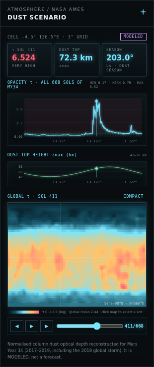

The right-hand **Dust scenario** panel is now a full graphical view of the NASA Ames Mars GCM MY34 dust scenario, clearly labelled **MODELED**:

* **KPI strip:** opacity τ for the selected sol with its backend class (LOW / MODERATE / HIGH / VERY HIGH), dust-top height and areocentric season Ls.
* **Opacity chart:** τ at the selected site across all 668 sols, with threshold bands from the backend's own dust classes, MIN / MEAN / MAX and a pulsing marker on the current sol. Click the chart to jump to a sol.
* **Dust-top height** sparkline on the same axis.
* **Global dust map** for the current sol with a crosshair on the site. Click it to select any coordinate.
* **Sol scrubber** with previous / next / play. The console sol is now adjustable (it used to be fixed at sol 100) and drives the environment assessment.
* The screenshot shows sol 411, the site's modeled dust peak (the 2018 global storm).

### 2. NEW · Site morphology (MIN / MEAN / MAX)

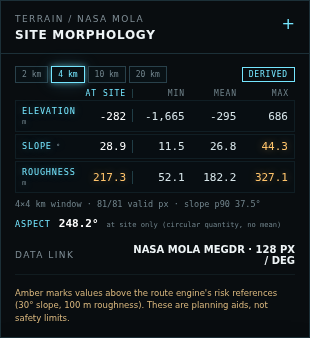

Elevation, slope and roughness now show **AT SITE** (the local MOLA sample) separately from **MIN / MEAN / MAX** over a selectable **2 / 4 / 10 / 20 km** NASA MOLA window, with the valid-pixel count and slope p90 as the stated basis. Values above the route engine's own risk references are flagged amber (a planning aid, not a safety limit). Aspect is shown at the site only, because the mean of a circular quantity is not meaningful.

### 3. NEW · Mission Command Index (the ☰ menu)

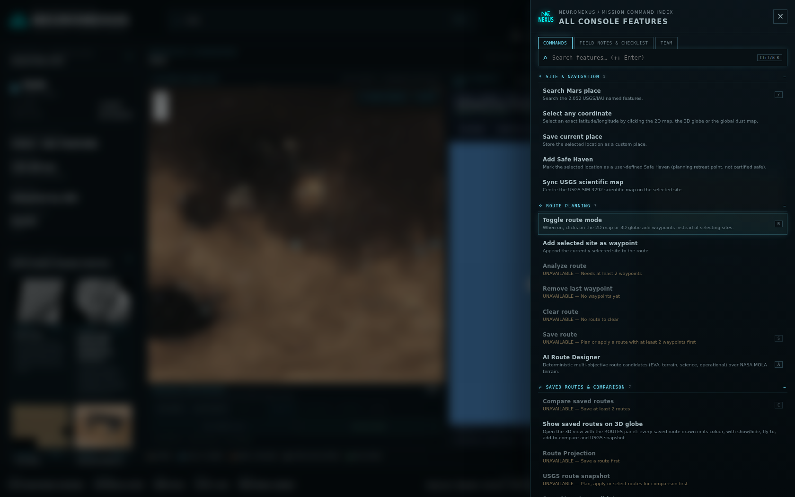

The ☰ button now opens a categorised **Command Index** with **every feature in the console**: Site & Navigation, Route Planning, Saved Routes & Comparison, Analysis & Intelligence, Environment, Views, Mission Operations, Data & Export, Workspace, and System & Team.

* **Search** and keyboard control (`Ctrl/⌘ + K` anywhere, ↑ ↓ Enter, Esc) plus single-key shortcuts (R route mode, S save route, C compare, I intelligence, 3 globe…).
* Unavailable actions **say why** (for example "Needs at least 2 waypoints") instead of silently greying out.
* Field notes and the checklist moved into a tab of the same panel.

### 4. NEW · Team NeuroNexus credits and Meet the Team

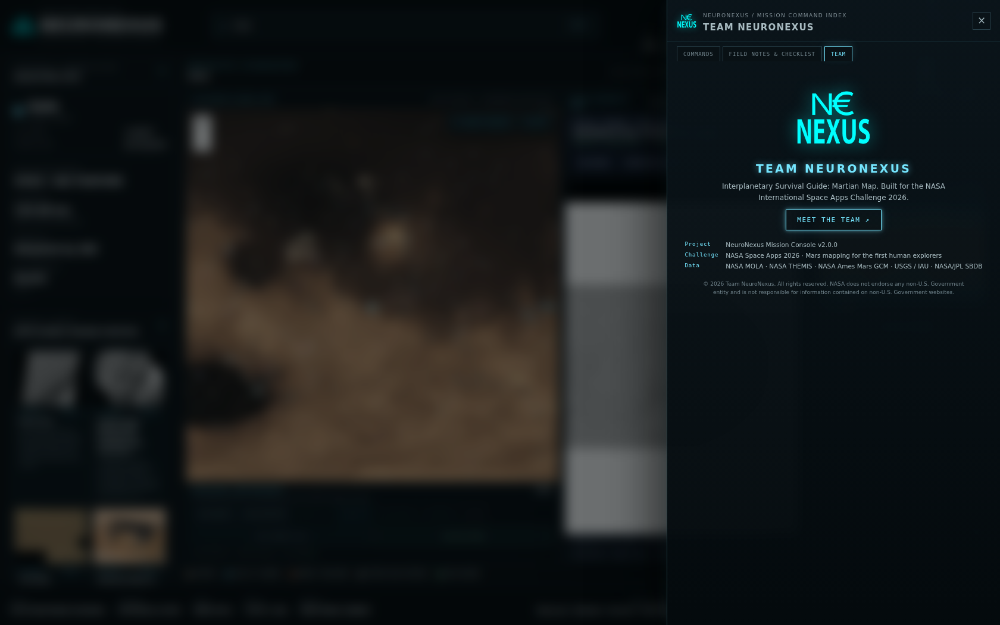

A **Team** tab in the Command Index (and **Meet the Team** in the Command Index list) opens our official Space Apps team page: https://www.spaceappschallenge.org/2026/find-a-team/neuronexus1/. The Team NeuroNexus logo appears in the top bar, the Command Index and the footer, with the copyright line and the NASA non-endorsement notice.

### 5. NEW · Mars Intelligence v2

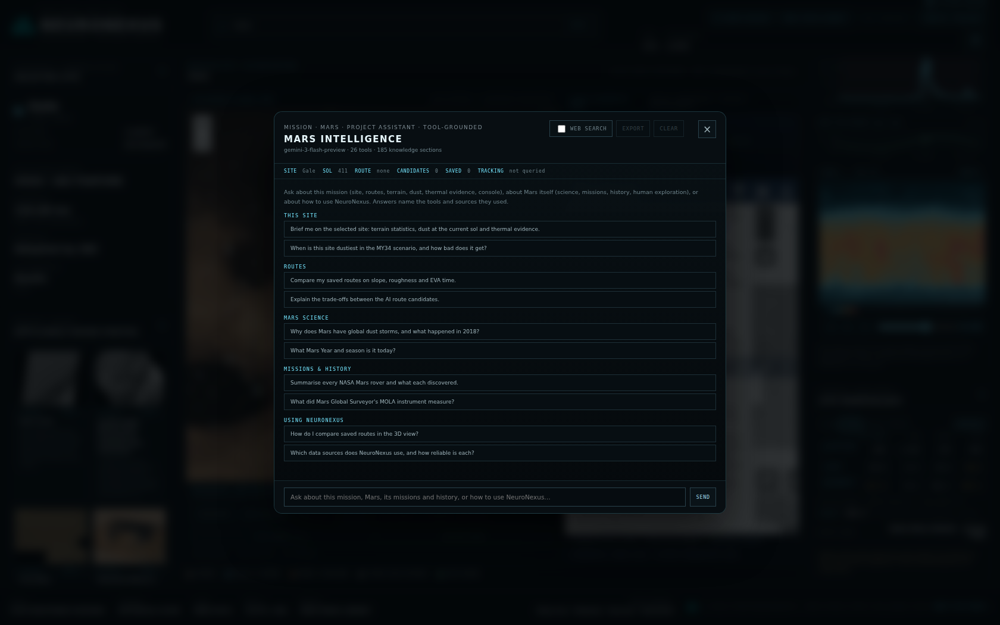

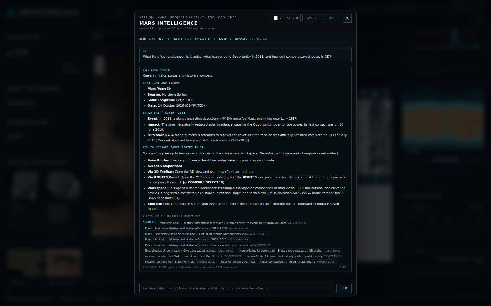

The assistant answers three kinds of question, not only tool lookups:

* **This mission:** site, routes, terrain statistics, dust at any sol, thermal evidence, the crewed console.
* **Mars:** planetary science, every NASA and partner-agency mission, history, human exploration, ISRU, and exact Mars time (Ls, Mars Year, season) computed for any date.
* **This app and project:** how to use every feature, data sources, setup, deployment, the team.

How it works: 26 tools (8 new), a curated and cited knowledge base (185 sections: reference notes, project docs and the UI command catalogue), and an optional **WEB SEARCH** toggle for recent events. Each answer lists the **tools it called** and the **sources it cited**, with per-section evidence classes (NASA REFERENCE, PROJECT DOCS, COMPUTED…). History persists, answers can be copied and the conversation exported as Markdown. The screenshot shows one question that used three tools: a Mars-time calculation, the missions library (Opportunity and the 2018 storm) and the UI guide.

### 6. NEW · Save AI-designed routes by name

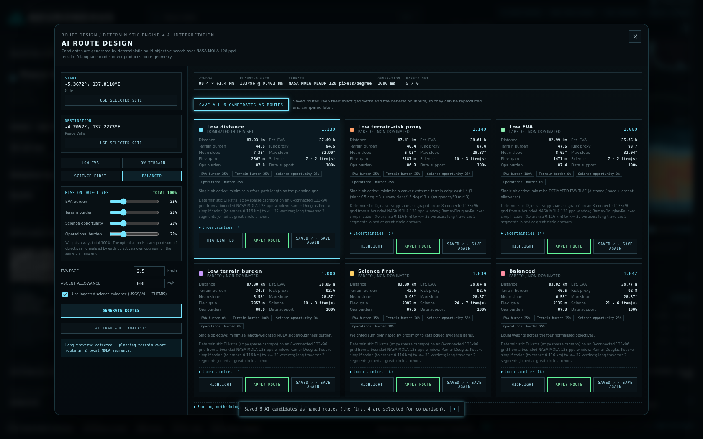

Every AI Route Designer candidate now has **SAVE AS ROUTE** (you choose the name), and **SAVE ALL CANDIDATES** saves the whole set under a name prefix. **Every saved route is reproducible:** it stores its exact geometry plus the inputs that produced it. For AI routes that is the exact generation request, objective weights, candidate id and engine version. Saved routes are numbered with a stable colour and appear in 2D, 3D, the comparison workspace, exports and the AI assistant.

### 7. NEW · Multi-route USGS snapshot

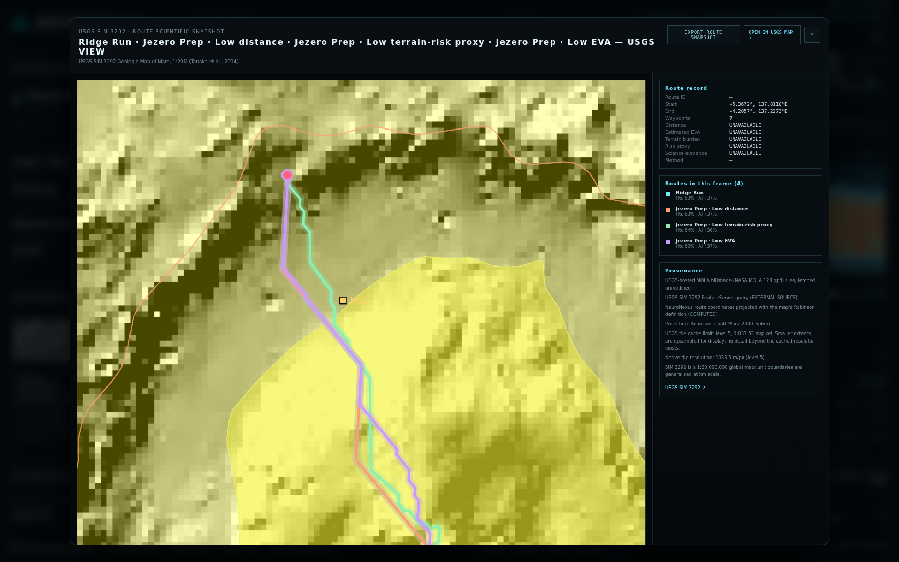

Select two or more routes for comparison and **USGS SNAPSHOT** draws **all of them in a single USGS SIM 3292 frame** over MOLA hillshade, each in its own colour with start and end markers, plus the geologic units each route crosses. With one route selected it behaves as before.

### 8. NEW · Route comparison workspace

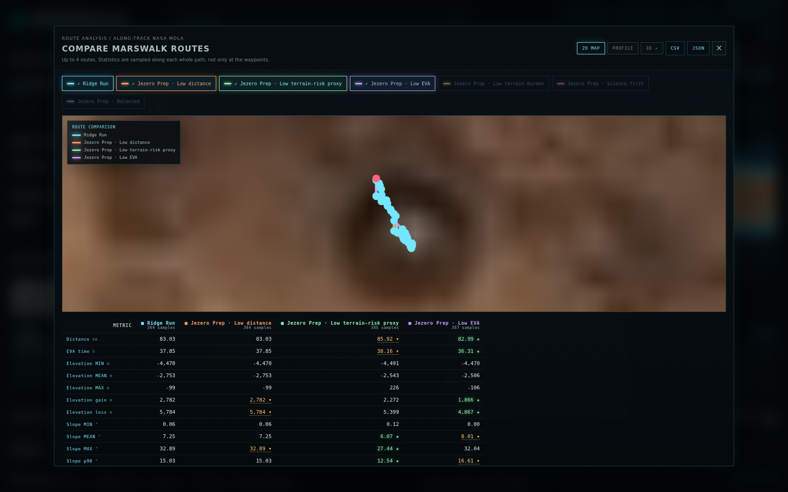

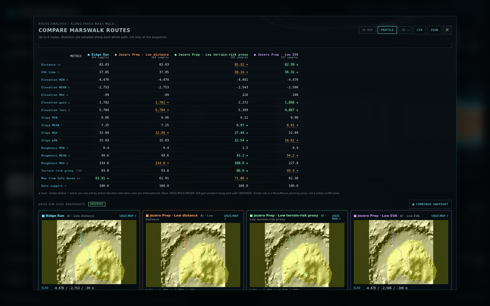

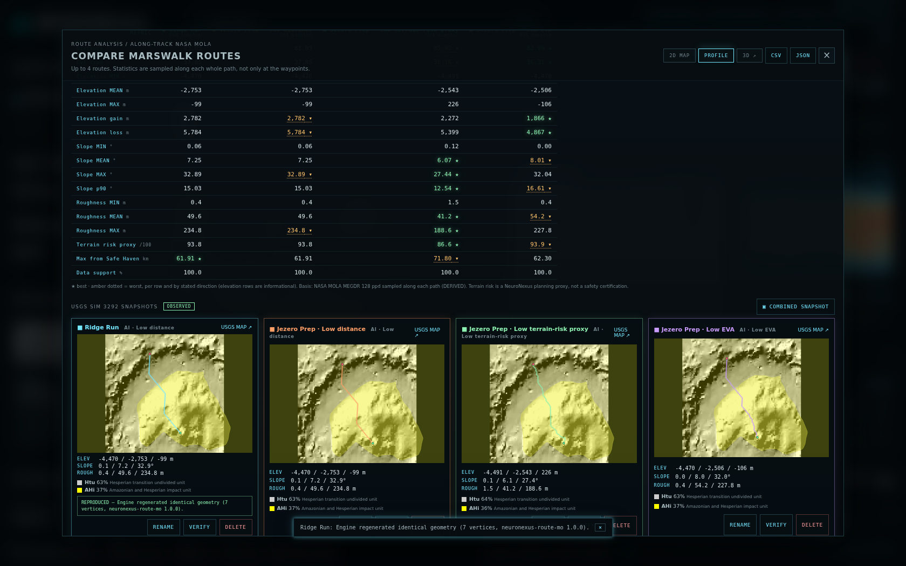

* **Along-track statistics:** every saved route is evaluated along its whole path (not only at the waypoints) over NASA MOLA, giving **MIN / MEAN / MAX** elevation, slope and roughness plus gain/loss, slope p90, terrain risk proxy, EVA time and data support.
* **Best and worst** are marked per row by the metric's stated direction (★ best, ▾ worst). Elevation rows are informational.
* **Overlaid elevation profiles** of all compared routes, up to four at a time.
* **Per-route USGS snapshot** with the units crossed, and a **COMBINED SNAPSHOT** frame. CSV and JSON export.
* **RENAME** and **VERIFY** on every card: AI routes replay the stored request and compare geometry vertex by vertex; manual routes re-run the deterministic evaluation. The result reads REPRODUCED, DIFFERS or ERROR.

### 9. NEW · Route Projection on the 3D globe

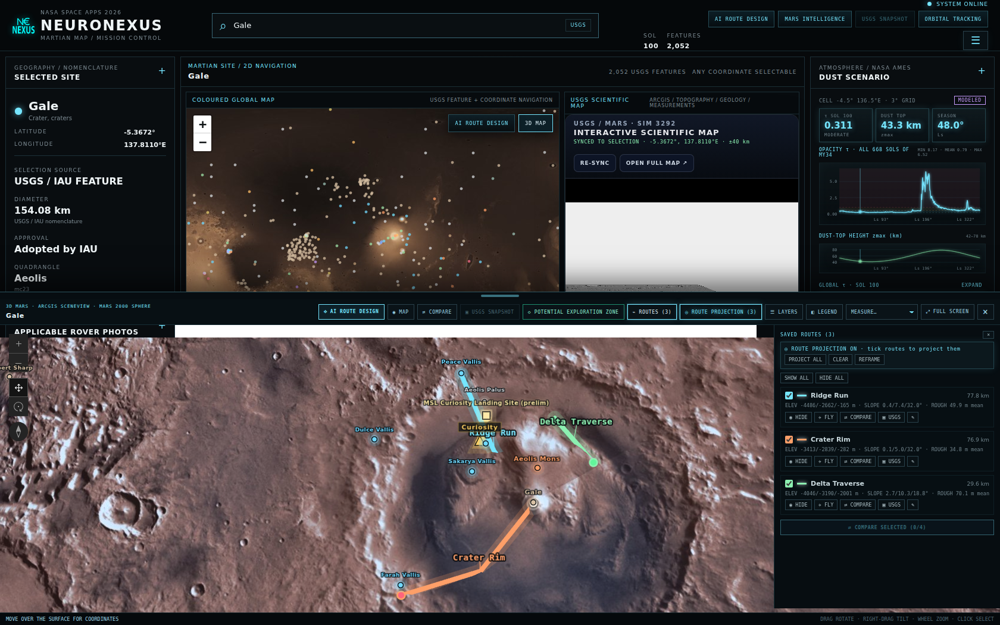

The 3D toolbar has a new **◎ ROUTE PROJECTION** button. Turn it on, **tick saved routes**, and each ticked route is projected bold above the terrain with its name and start/end markers; unticked routes fade. The camera reframes to show every ticked route whenever the selection changes (PROJECT ALL, CLEAR and REFRAME buttons are in the panel). The 3D **⌁ ROUTES** panel also gives per-route show/hide, fly-to, compare, USGS and rename.

### Also new

* Deployment guide ([DEPLOYMENT.md](DEPLOYMENT.md)) with local, Docker Compose and split-hosting options.
* Test suites for the new engines (dust, terrain statistics, along-track statistics, snapshots, Mars time, knowledge base, route reproducibility) and for the command registry.
* Fixes: the NASA briefing endpoint no longer fails on repeated requests, and first-time USGS snapshots place routes at the right scale.

## Screenshots : the mission console in action

The screenshots below show the Master-Ai interface, including Gale site context, historical thermal evidence, route comparison, and the interactive 3D workspace. Displayed values belong to the captured application state used in this project.

### Site selection and synchronized maps

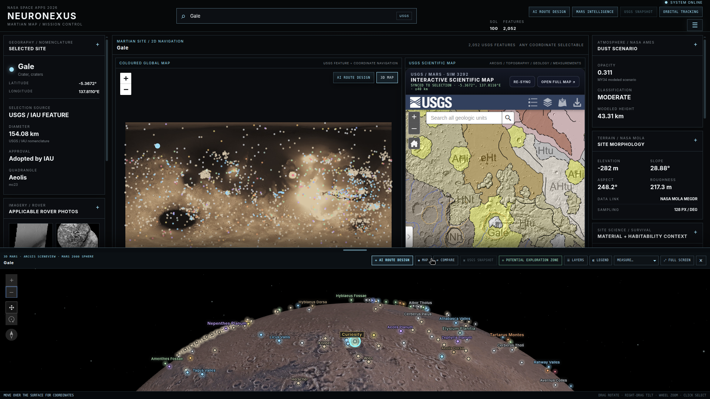

The main console brings USGS/IAU site identity and coordinates, applicable rover imagery, NASA Ames dust-model context, and NASA MOLA terrain metrics alongside the 2D, USGS geology, and 3D views.

### Historical THEMIS thermal evidence

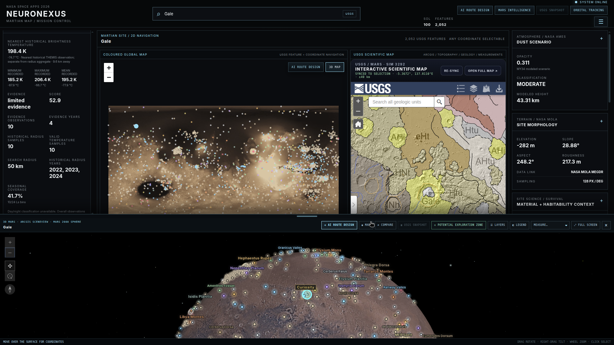

The THEMIS panel keeps the nearest historical brightness temperature separate from the minimum, maximum, and mean shown directly beneath it in Kelvin and Celsius. Historical sample counts, the 50 km search radius, observation years, and seasonal coverage are available beside the thermal series.

### AI Route Designer : deterministic candidates

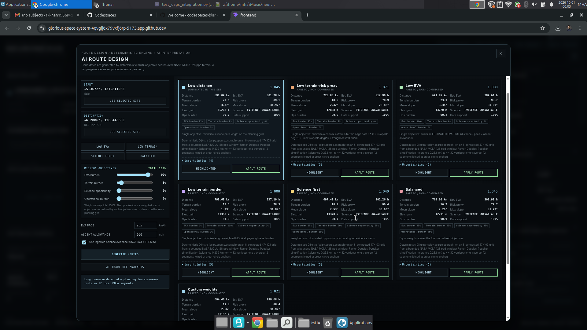

The route-design workspace lets users set start and destination coordinates, adjust mission-objective weights, and configure EVA pace and ascent allowance. Candidate cards compare distance, estimated travel time, terrain burden, roughness, and route suitability.

### Saved-route comparison

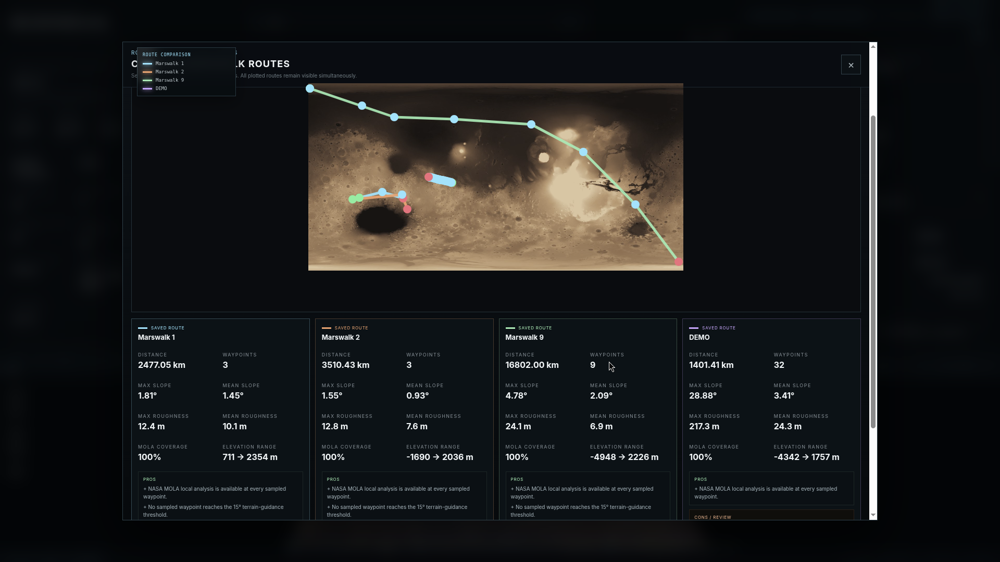

Colour-coded saved routes remain visible together while comparison cards show distance, waypoint counts, slope, roughness, MOLA coverage, elevation range, and review notes.

### Mars Intelligence : tool-grounded interpretation

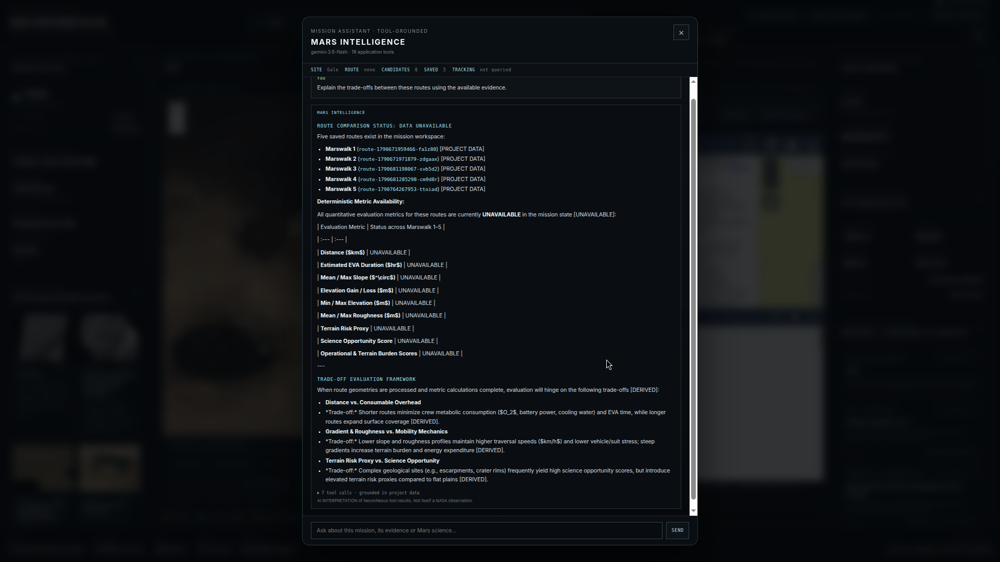

Mars Intelligence uses structured mission context and application tools to explain evidence and route trade-offs. This captured response lists saved routes but marks their quantitative comparison as unavailable when the deterministic metric is not present.

### Interactive 3D layers

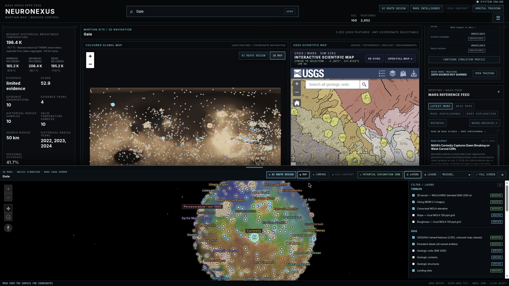

The 3D layer panel groups terrain, imagery, colourised elevation, USGS/IAU named features, geology, and landing-site overlays. Observed and derived labels distinguish source data from NeuroNexus computed values.

### Map legend and rover context

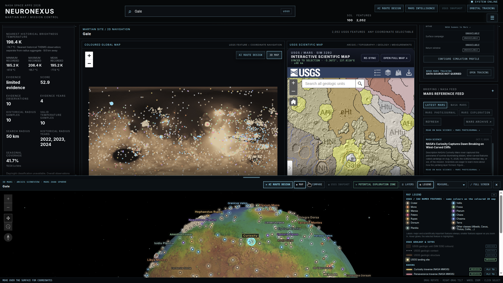

The legend explains named-feature colours, geologic symbols, landing sites, and rover-traverse layers. It keeps the map symbology and provenance labels visible beside the interactive scene.

### Potential exploration zones

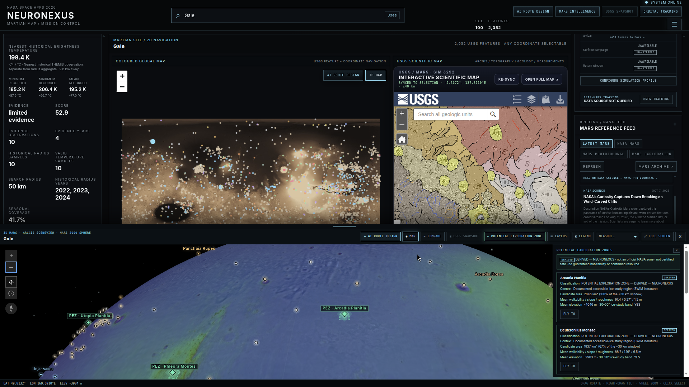

The exploration-zone view connects derived candidate areas to documented study-region context and terrain summaries, with controls to fly to a region. These zones are NeuroNexus planning aids—no single zone is declared "safe" or habitable.

### Field notes and mission checklist

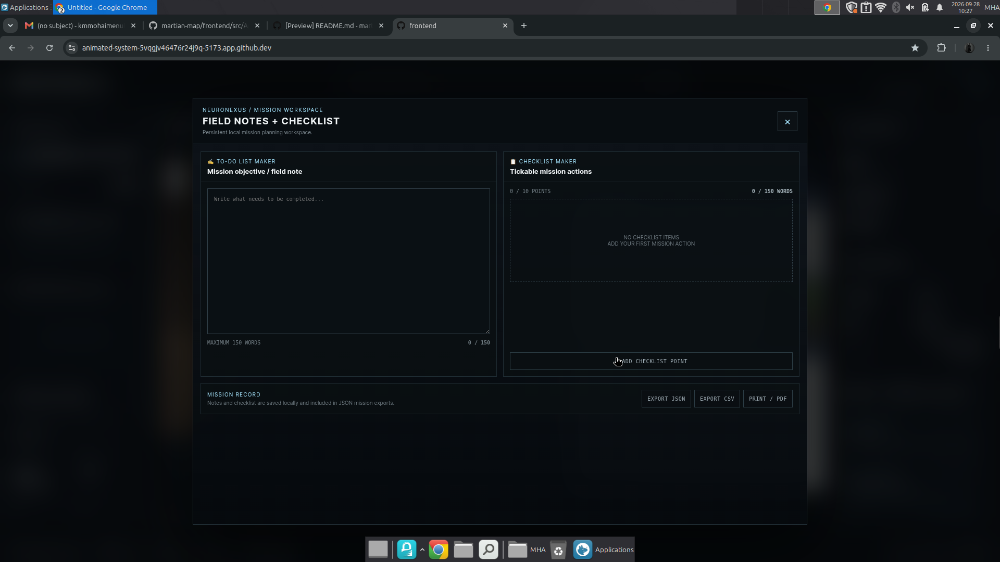

The mission workspace keeps field notes and tickable checklist actions alongside the planning workflow. It supports local-save persistence and export to JSON, CSV, and printable or PDF formats.

## Scientific data and external sources

# NASA

* NASA Planetary Data System (PDS): primary archival source framework.
* Mars Global Surveyor / MOLA: MEGDR 128 pixels/degree global topography and 512 pixels/degree polar topography for elevation and terrain analysis.
* Mars Odyssey / THEMIS: historical visible and thermal observations, including IR predicted brightness-temperature context.
* NASA Ames Research Center Mars Global Climate Model: MY34 dust scenario used for modelled dust context.
* Mars Science Laboratory / Curiosity: rover science context and historical RAD surface-radiation reference.
* Mars 2020 / Perseverance: mission science context and rover traversal data.
* NASA MMGIS: real Curiosity and Perseverance traverse layers used by the 3D rover-path visualisation.
* NASA Image and Video Library: mission and rover imagery metadata.
* NASA human-exploration references: EVA, Mars mission, radiation, Martian dust, life-support and mobility context.
* NASA SWIM / NASA Mars Water Maps: accessible-ice exploration context. The full SWIM ice-consensus raster is explicitly marked UNAVAILABLE in NeuroNexus; documented study regions are not presented as a substitute.

# USGS / IAU

* USGS Gazetteer of Planetary Nomenclature / IAU: 2,052 named Martian features, coordinates, feature types, and identity.
* USGS SIM 3292 — Geologic Map of Mars (Tanaka et al., 2014): geologic units, contacts, structures, landing-site layer, and scientific route snapshots.

# NASA/JPL

* NASA/JPL Solar System Dynamics Close-Approach Data API: near-Mars small-body close-approach awareness, distance and uncertainty information.

# Other external services and partners

* Esri / ArcGIS Mars services: public Mars terrain/elevation services, Viking MDIM imagery, colourised elevation, and ArcGIS delivery of USGS geology used by the 3D experience.
* ESA: Mars Express and ExoMars public feeds used by the Mars briefing subsystem.
* The Planetary Society: public Mars article feed used by the Mars briefing subsystem.
* Google Gemini API: AI interpretation of structured NeuroNexus results; the API key remains server-side and Gemini output is never treated as a NASA observation.

The machine-readable provenance ledger is available at data/manifests/source_ledger.json.

# Evidence and provenance

NeuroNexus distinguishes:

* OBSERVED / NASA OBSERVED - measurements or archived observations from a named source.
* NASA REFERENCE - published NASA/USGS reference information or catalogue data.
* MODELED - output of a physical model such as the NASA Ames Mars GCM.
* DERIVED / COMPUTED - values calculated by NeuroNexus from source data.
* SIMULATED - configurable project simulation values.
* UNAVAILABLE - no ingested evidence; NeuroNexus does not invent a substitute.

Examples of NeuroNexus-derived outputs include the multi-objective route engine, route metrics, walkability score, terrain-risk proxy, EVA-time estimate, and potential exploration-zone scoring.

NeuroNexus does not label any route or location as NASA-certified safe, universally best, habitable, or resource-confirmed.

# Architecture
```
Authoritative Mars data
        ↓
Ingestion + validation
        ↓
Scientific indexes / bounded terrain windows
        ↓
Deterministic terrain + route analysis
        ↓
FastAPI mission services
        ↓
React/Vite mission console
        ↙       ↓        ↘
     2D map   3D Mars   USGS map
        ↘       ↓        ↙
          shared mission state
                ↓
          Google Gemini
                ↓
AI interpretation of structured results
```
# Architecture (Mermaid Diagram)
# Architecture

```mermaid
flowchart TB
    USER["Mission operator"] --> APP

    subgraph FRONTEND["PRESENTATION LAYER · React 19 + Vite"]
        APP["App.jsx<br/>Shared mission state and UI orchestration"]

        MAP2D["2D Mars Explorer<br/>Leaflet · site search · map selection"]
        TOPO["MOLA Topographic Explorer<br/>Elevation tiles · contours · local terrain"]
        MAP3D["Interactive 3D Mars<br/>ArcGIS SceneView · loaded on demand"]
        ROUTEUI["Route Design, Saving & Comparison<br/>Waypoints · objective weights · EVA settings<br/>Named AI routes · along-track stats · Verify · 3D Route Projection"]
        DUSTUI["Dust & Morphology Panels<br/>Opacity over 668 sols · global dust map · sol scrubber<br/>AT SITE + MIN / MEAN / MAX terrain statistics"]
        CMDUI["Mission Command Index (☰)<br/>Every feature by category · search · shortcuts<br/>Notes · Team NeuroNexus · Meet the Team"]
        OPSUI["Science & Mission Panels<br/>Environment · hazards · thermal · rover photos<br/>Briefings · orbital tracking · mission operations"]
        INTELUI["Mars Intelligence<br/>Grounded Q&A · route trade-off explanations<br/>Mars science · missions · history · app guide · web-search toggle"]
        NOTES["Field Notes & Checklist<br/>Custom places · Safe Havens · exports"]

        CLIENT["marsEnvironmentApi.js<br/>REST / JSON client"]
        STORAGE[("Browser localStorage<br/>Saved routes (v3, with generation record) · profile · places · notes<br/>Checklist · Safe Havens · objectives · console sol")]
        IDB[("Browser IndexedDB<br/>USGS snapshot cache")]

        APP <--> MAP2D
        APP <--> TOPO
        APP <--> MAP3D
        APP <--> ROUTEUI
        APP <--> OPSUI
        APP <--> INTELUI
        APP <--> NOTES
        APP <--> DUSTUI
        APP <--> CMDUI
        APP <--> STORAGE
        ROUTEUI <--> IDB

        APP --> CLIENT
        MAP3D --> CLIENT
    end

    subgraph TRANSPORT["LOCAL API TRANSPORT"]
        PROXY["Vite proxy<br/>/api/* and /terrain/*"]
        API["FastAPI application · port 8002<br/>science/weather/api/environment.py"]
        PROXY <--> API
    end

    CLIENT <-->|"REST requests and JSON responses"| PROXY

    subgraph ROUTERS["FASTAPI DOMAIN ROUTERS"]
        SITEAPI["Environment & Place Catalogue<br/>Site context · USGS/IAU search"]
        TERRAINAPI["Terrain API<br/>Tiles · contours · windows (MIN / MEAN / MAX) · route geometry"]
        ROUTEAPI["Routing API<br/>Candidates · evaluation (along-track stats, profiles) · methodology"]
        USGSAPI["USGS API<br/>Map synchronisation · route snapshots (single and multi-route)"]
        DUSTAPI["Dust API<br/>Timeseries · global map · metadata"]
        MARS3DAPI["Mars3D API<br/>Terrain grids · traverses · exploration zones"]
        HAZARDAPI["Hazards API<br/>Hazard overview · AI context"]
        MISSIONAPI["Mission API<br/>Explicitly simulated mission state"]
        ORBITAPI["Orbital API<br/>Near-Mars close approaches"]
        AIAPI["AI API<br/>Chat · route analysis · provenance<br/>Provider switch"]
        MEDIAAPI["Briefing & Rover Media<br/>NASA and partner feeds · rover imagery"]
    end

    API --> SITEAPI
    API --> TERRAINAPI
    API --> ROUTEAPI
    API --> USGSAPI
    API --> MARS3DAPI
    API --> HAZARDAPI
    API --> MISSIONAPI
    API --> ORBITAPI
    API --> AIAPI
    API --> DUSTAPI
    API --> MEDIAAPI

    subgraph ENGINES["SCIENTIFIC & COMPUTATIONAL CORE"]
        ENV["MarsEnvironmentEngine<br/>Unified site context"]
        THERMAL["THEMIS Thermal Engine<br/>Historical brightness temperatures · coverage"]
        WEATHER["Mars Weather Model<br/>NASA Ames MY34 dust context"]
        TERRAIN["MOLA Terrain Processing<br/>Slope · roughness · relief · raster rendering"]
        ROUTING["Deterministic Multi-objective Route Engine<br/>Candidate generation · metrics · EVA estimates"]
        MAP3DENGINE["Mars 3D Context Builder<br/>Local terrain · rover traverses · study regions"]
        HAZARD["Hazard & Site Science Logic"]
        SIM["Mission Simulation Model<br/>Crew · vehicles · EVA · life support"]
        ORBITAL["Orbital Data Adapter"]
        MEDIA["Briefing & Imagery Adapters"]
        TOOLS["Server-side AI Tool Registry · 26 tools<br/>Reads structured site, terrain, route,<br/>thermal, hazard, dust and orbital context<br/>Mars-time calculator · gazetteer · landing sites"]
        KB["Knowledge Base · BM25 retrieval<br/>Mars science · missions · history · project docs<br/>UI command catalogue · cited sections"]
        PROVENANCE["Source Ledger & Evidence Classification<br/>Observed · Reference · Modelled · Derived<br/>Simulated · Unavailable"]
    end

    SITEAPI --> ENV
    SITEAPI --> PROVENANCE
    TERRAINAPI --> TERRAIN
    ROUTEAPI --> ROUTING
    USGSAPI --> PROVENANCE
    MARS3DAPI --> MAP3DENGINE
    HAZARDAPI --> HAZARD
    MISSIONAPI --> SIM
    ORBITAPI --> ORBITAL
    MEDIAAPI --> MEDIA
    AIAPI --> TOOLS
    AIAPI --> PROVENANCE
    DUSTAPI --> WEATHER
    TOOLS --> KB

    subgraph LOCALDATA["LOCAL SCIENTIFIC DATA"]
        MOLA["NASA MOLA MEGDR<br/>Terrain tiles · Git LFS"]
        THEMIS["NASA THEMIS IR-PBT<br/>Indexed historical observations · Parquet"]
        DUST["NASA Ames Mars GCM · MY34<br/>NetCDF · external/mars-gcm submodule<br/>(repository-root copy as fallback)"]
        GAZETTEER["USGS / IAU Gazetteer<br/>Processed feature catalogue · Parquet"]
        MANIFEST["data/manifests<br/>Source ledger · checksums · dataset metadata"]
    end

    MOLA --> TERRAIN
    MOLA --> ROUTING
    MOLA --> MAP3DENGINE
    MOLA --> ENV

    THEMIS --> THERMAL
    THERMAL --> ENV

    DUST --> WEATHER
    DUST --> DUSTAPI
    WEATHER --> ENV

    GAZETTEER --> ENV
    MANIFEST --> PROVENANCE

    TOOLS --> ENV
    TOOLS --> THERMAL
    TOOLS --> TERRAIN
    TOOLS --> ROUTING
    TOOLS --> ORBITAL
    TOOLS --> WEATHER
    TOOLS --> PROVENANCE

    subgraph EXTERNAL["EXTERNAL DATA & SERVICES"]
        ARCGIS["Esri ArcGIS Mars Services<br/>Imagery · elevation · geology"]
        MMGIS["NASA MMGIS<br/>Rover traverse context"]
        JPL["NASA/JPL Close-Approach API"]
        FEEDS["NASA · ESA · Planetary Society<br/>Briefing feeds and mission context"]
        IMAGES["NASA Image and Video Library"]
        GEMINI["Google Gemini API<br/>Optional · server-side only"]
    end

    MAP3D <--> ARCGIS
    USGSAPI <--> ARCGIS
    MAP3DENGINE <--> MMGIS
    ORBITAL <--> JPL
    MEDIA <--> FEEDS
    MEDIA <--> IMAGES

    AIAPI <--> GEMINI
    GEMINI -. "Function-call requests" .-> TOOLS
    TOOLS -. "Structured tool results" .-> GEMINI

    ROUTING -. "Deterministic route metrics remain authoritative" .-> INTELUI
    ENV -. "Scientific context and evidence status" .-> OPSUI
    WEATHER -. "Modeled dust series (MODELED, not a forecast)" .-> DUSTUI
    KB -. "Cited Mars, mission and app knowledge" .-> INTELUI
```
# Simplified Architecture Mermaid Diagram 

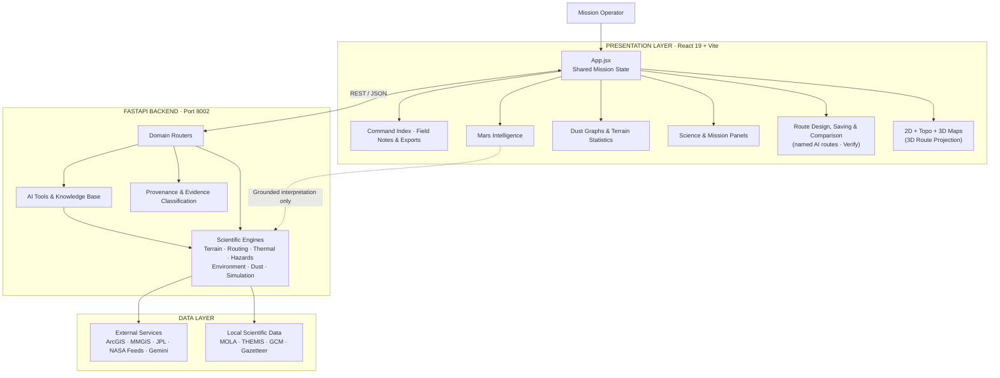

# Stack

# Frontend

* React 19
* Vite
* Leaflet / React-Leaflet
* ArcGIS Maps SDK for JavaScript, loaded on demand for 3D

# Backend

* Python
* FastAPI + Uvicorn
* NumPy / SciPy / Pandas / Polars / PyArrow
* Rasterio / GeoPandas / Shapely / PyProj
* PDS4 Tools
* VTK / PyVista / Trimesh
* Google GenAI SDK

# Acceleration / development

* AMD Instinct MI300X + ROCm for terrain and engineering acceleration work
* Large/generated datasets and assets are handled through manifests, Git LFS, submodules, or external services where appropriate.

# Gemini AI setup

AI is optional for the rest of NeuroNexus.

Create .env in the repository root:

GEMINI_API_KEY=your_gemini_api_key_here
GEMINI_MODEL=gemini-3.6-flash

A safe template is provided as .env.example.

Never commit a real Gemini API key. The backend reads GEMINI_API_KEY; it is never sent to the browser.

For the complete setup and model troubleshooting flow, see SETUP_INSTRUCTIONS.md.

# Quick start

Use the full SETUP_INSTRUCTIONS.md for installation, data acquisition, Gemini configuration and startup.

The intended branch is:

Master-Ai

Backend:
```
python -m uvicorn science.weather.api.environment:app --host 127.0.0.1 --port 8002
```
Frontend:
```
cd frontend
npm install
npm run dev
```

# Validation

## What's validated (against real rover ground truth)

Every number below is generated from `validation/reports/latest.json`; full method, caveats and the claims we could not reproduce are in [docs/VALIDATION.md](docs/VALIDATION.md).

<!-- VALIDATION:START -->

Run `20261020-4c5fb3e5` · generated 2026-10-20T04:43:42+00:00 · `python -m science.validation.run --site all`

| site | id | metric | value | 95% CI | n | what it means |
| --- | --- | --- | --- | --- | --- | --- |
| Gale | V3 | Rover tilt vs HiRISE slope @3 m | **ρ = 0.37** | 0.32 – 0.41 | 1,386 | rank correlation between the rover's IMU tilt and the DTM slope at the vehicle's scale |
| Gale | V3 | HiRISE @3 m p90 ratio (tilt / slope) | **0.99×** | 0.89 – 1.07 | 1,386 | 1.00× means the meter-scale map reproduces the steep tail the rover felt |
| Gale | V3 | MOLA-only p90 underestimate | **1.79×** | 1.7 – 1.85 | 1,386 | the rover's 90th-percentile tilt is this many times the MOLA 463 m slope |
| Gale | V1 | Rover vs HiRISE elevation NMAD | **4.8 m** | 4.4 – 5.2 | 1,386 | consistency check (bias -8.7 m); localization is tied to HiRISE |
| Gale | V4 | Ladder plan within 10 m of the real drive | **45%** | 40.0 – 54.0 | 40 | median share per leg; MOLA-only 41% |
| Gale | V7 | RAD dose rate vs surface pressure | **ρ = 0.10** | -0.08 – 0.27 | 121 | published anticorrelation NOT reproduced in this sample |
| Gale | V6 | HiRISE − CTX vertical step (median) | **6.6 m** | 7.0 – 7.7 | 1,386 | 92% of waypoint windows exceed the 2 m seam flag |
| Gale | V5 | Plans byte-identical on rerun | **20/20** |  | 20 | same request + data versions → same plan |
| Jezero | V3 | Rover tilt vs HiRISE slope @3 m | **ρ = 0.51** | 0.42 – 0.6 | 321 | rank correlation between the rover's IMU tilt and the DTM slope at the vehicle's scale |
| Jezero | V3 | HiRISE @3 m p90 ratio (tilt / slope) | **0.92×** | 0.77 – 1.09 | 321 | 1.00× means the meter-scale map reproduces the steep tail the rover felt |
| Jezero | V3 | MOLA-only p90 underestimate | **2.35×** | 1.77 – 2.62 | 706 | the rover's 90th-percentile tilt is this many times the MOLA 463 m slope |
| Jezero | V1 | Rover vs HiRISE elevation NMAD | **6.7 m** | 5.7 – 7.4 | 321 | consistency check (bias -7.0 m); localization is tied to HiRISE |
| Jezero | V4 | Ladder plan within 10 m of the real drive | **41%** | 30.0 – 50.0 | 40 | median share per leg; MOLA-only 27% |
| Jezero | V6 | HiRISE − CTX vertical step (median) | **-19.4 m** | -19.5 – -17.3 | 321 | 96% of waypoint windows exceed the 2 m seam flag |
| Jezero | V5 | Plans byte-identical on rerun | **20/20** |  | 20 | same request + data versions → same plan |

<!-- VALIDATION:END -->

## Test suites

The repository contains tests covering AI behaviour, routing, USGS integration, orbital tracking, Mars 3D services, exports, and other mission subsystems.

Run:
```
python -m pytest tests -q
cd frontend && node --test "tests/*.test.js"
npm run build
```

Runtime notes

* The ArcGIS 3D experience loads only when opened and requires internet access to Esri's public services.
* The NASA MOLA raw terrain dataset is large; follow the Git LFS/PDS instructions in SETUP_INSTRUCTIONS.md.
* The SWIM water-ice consensus raster is currently UNAVAILABLE in the application; related regions are presented only as documented exploration-study context.
* Some high-resolution orbital datasets listed in the scientific catalogue remain explicitly not-ingested rather than being fabricated.
* The 3D terrain service and local MOLA measurements may differ because they come from different terrain products/resolutions; NeuroNexus keeps that distinction explicit.

# Repository

NASA Space Apps 2026 submission branch:
https://github.com/kmmohaimenulhaque-code/martian-map/tree/Master-Ai

# Source ledger:
https://github.com/kmmohaimenulhaque-code/martian-map/blob/Master-Ai/data/manifests/updated_source_ledger.json


## Project tour: the whole console in screenshots

Captured from the production build (`npm run build` + `vite preview`) running against the live FastAPI backend. Everything below is the actual application, not mock-ups. Features marked **NEW** are described in the [NEW FEATURES](#-new-features--mission-console-v2) section above.

### The mission console

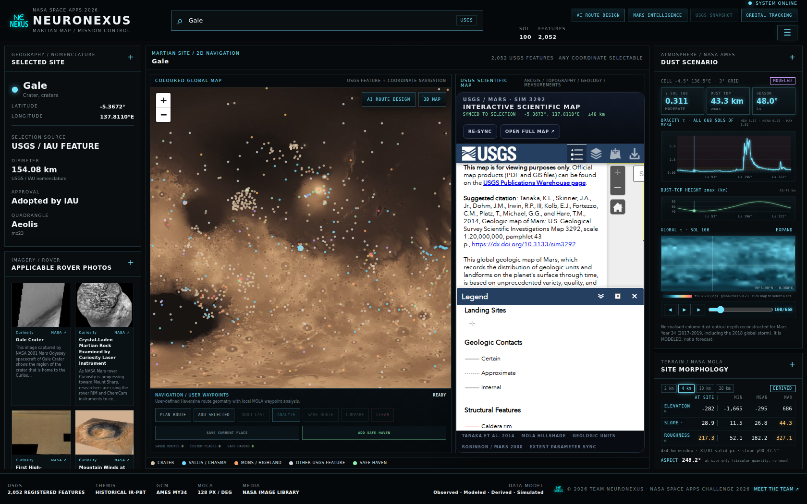

One screen holds the whole mission picture. The **left column** is the site evidence (geography, rover imagery, THEMIS thermal evidence, solar geometry). The **centre** is the synchronised **2D coloured Mars map** and the embedded **USGS scientific map**, with the route console beneath. The **right column** carries the **NEW** dust graphics and terrain statistics, site science, the interpretation panel, the crewed console and the NASA feed. The top bar has site search over 2,052 USGS/IAU features, the sol, the system status and the main tools; the **NEW** ☰ Command Index sits at the top right. The footer lists every data source and the **NEW** Team NeuroNexus credits.

### Site evidence (left column)

| | |
|---|---|
| 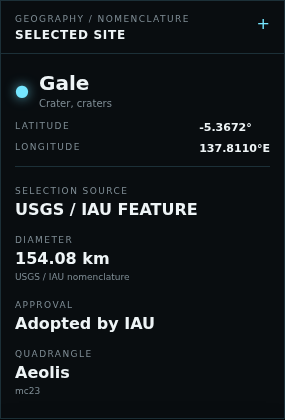 | **Selected site.** Name, feature type, exact coordinates, whether the selection is a USGS/IAU named feature, a user place or a bare coordinate, with its diameter, IAU approval status and USGS quadrangle. Any coordinate on Mars can be selected, and nearby nomenclature is shown only as context. |
| 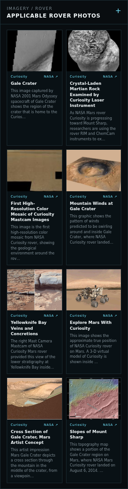 | **Applicable rover photos.** NASA Image and Video Library items matched to the selected feature (here Curiosity at Gale), each linked back to NASA. |
| 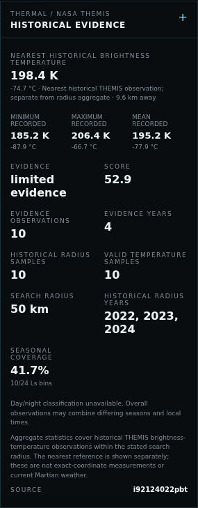 | **Historical THEMIS thermal evidence.** The nearest historical brightness temperature is shown separately from the minimum, maximum and mean within the search radius, with sample counts, observation years, seasonal coverage and an evidence score. These are historical NASA Odyssey observations, not current weather. |
| 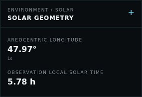 | **Solar geometry.** Areocentric longitude (Ls) for the console sol, which now follows the **NEW** sol scrubber. |

### Right column: science and mission panels

| | |
|---|---|
| 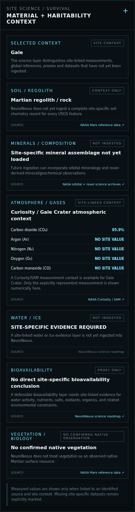 | **Site science and survival context.** Soil, minerals, atmosphere (Curiosity/SAM gas fractions for Gale), water and ice, bioavailability and biology, each with an explicit status such as CONTEXT ONLY, NOT INGESTED or PROXY ONLY, so missing evidence is stated and never invented. |
| 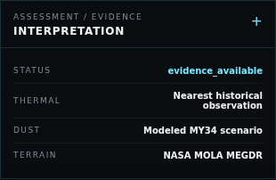 | **Interpretation.** The assessment status and the evidence class behind each input: historical thermal observation, **modeled** MY34 dust scenario, NASA MOLA terrain. |
| 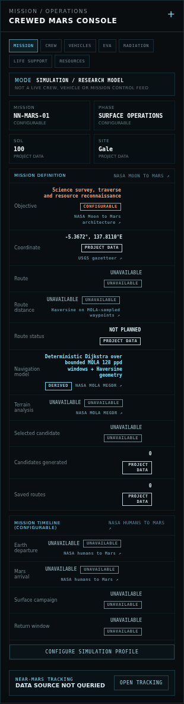 | **Crewed Mars console.** An explicitly simulated mission model (crew, vehicles, EVA, radiation, life support, resources) with a configurable profile. Every row carries its evidence badge (PROJECT DATA, DERIVED, CONFIGURABLE, UNAVAILABLE) and source link. It is not a live mission feed. |
| 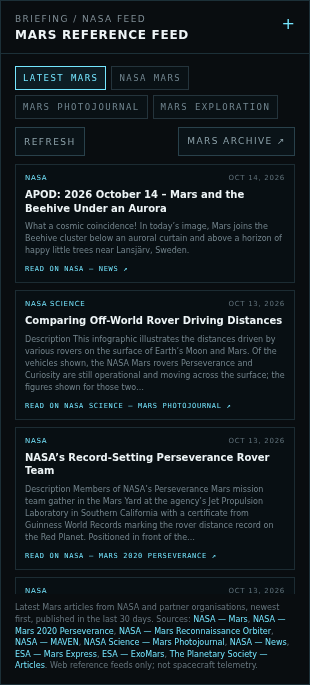 | **Mars reference feed.** Latest Mars items from NASA Science and partner agencies, filterable by source, with a link to the archive. |

### Maps and routes

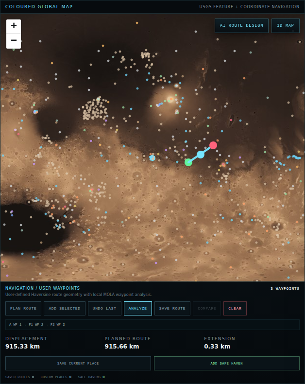

**2D coloured global map and route planning.** 2,052 USGS/IAU features are clickable and colour-coded by type. Turn on **PLAN ROUTE**, click waypoints, and **ANALYZE** returns the haversine displacement and planned length with NASA MOLA terrain analysed at every waypoint. **SAVE ROUTE**, **COMPARE**, custom places and Safe Havens live in the same console. Saved routes are the basis of the **NEW** comparison, projection and snapshot features.

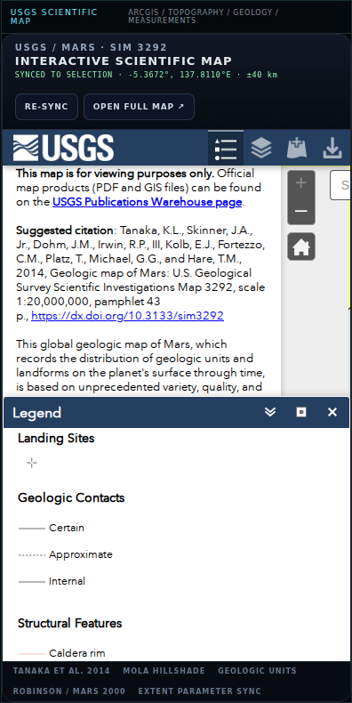

**USGS scientific map.** The embedded USGS Geologic Map of Mars (SIM 3292) synchronises to the selected site (here ±40 km around Gale) with its legend for landing sites, geologic contacts and structural features. **USGS SNAPSHOT** renders routes on this geology (the **NEW** multi-route snapshot draws every compared route in one frame).

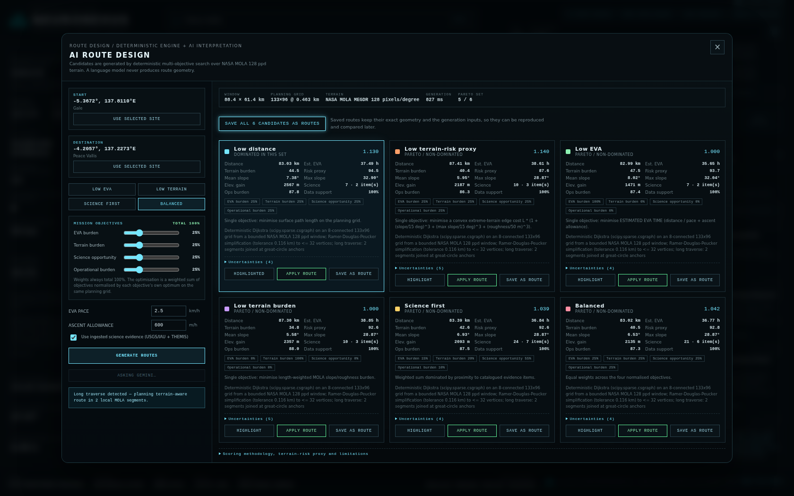

**AI Route Designer.** Deterministic multi-objective routing over NASA MOLA terrain generates six candidates (low distance, low terrain-risk, low EVA, low terrain burden, science first, balanced), each with distance, EVA time, terrain burden, slopes, elevation gain, science evidence and its Pareto status, plus the method used and the uncertainties. The AI never produces route geometry. **NEW:** every candidate can be saved by name.

### 3D Mars

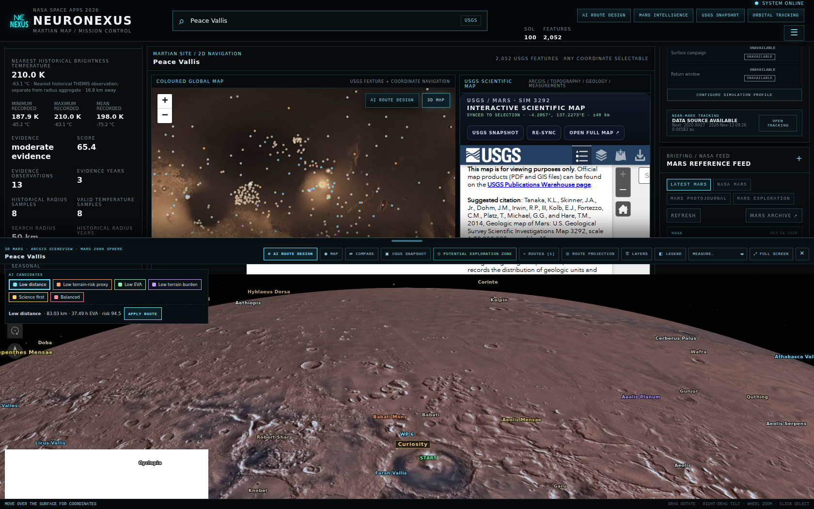

**Interactive 3D Mars.** An ArcGIS SceneView in Mars 2000 coordinates over public Mars terrain and imagery, with named features, landing sites, rover locations and the AI route candidates (here a Gale to Peace Vallis route). The toolbar gives AI Route Design, compare, USGS snapshot, exploration zones, the **NEW** ⌁ ROUTES panel and ◎ ROUTE PROJECTION, layers and legend.


**3D layers.** Every layer is tagged with its evidence class (OBSERVED or DERIVED): 3D terrain, Viking imagery, colourised elevation, local MOLA slope and roughness, USGS named features, geologic units, contacts and structures, landing sites, and Curiosity and Perseverance traverses.

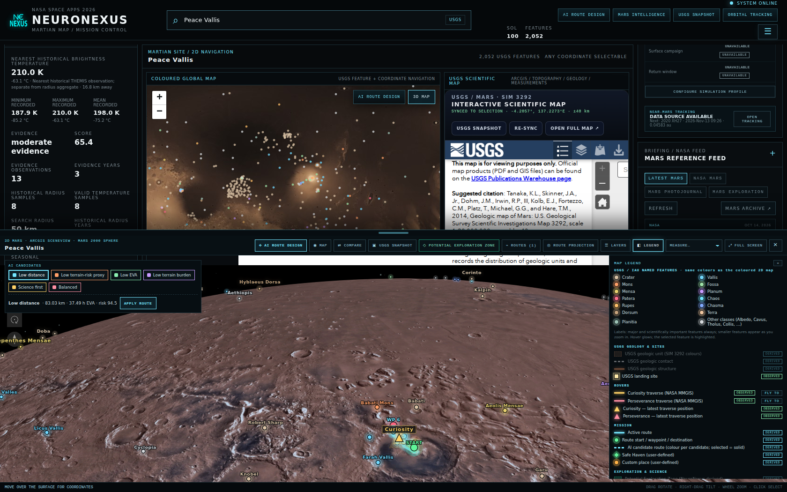

**Map legend.** The symbols for features, routes, landing sites, rovers and overlays.

### Mission awareness and workspace

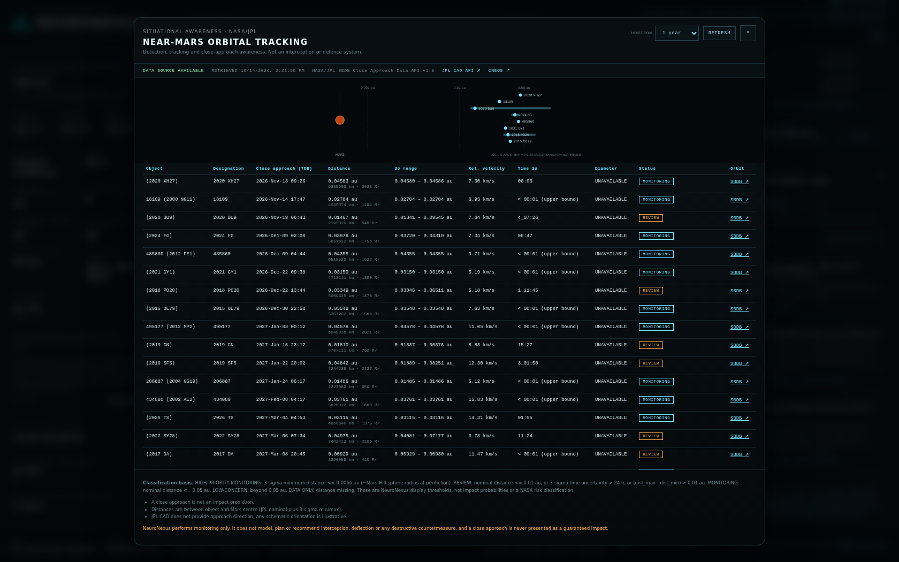

**Near-Mars orbital tracking.** Live NASA/JPL close approaches within a selectable horizon, drawn on a log-distance schematic and listed with distance, 3-sigma range, relative velocity and status (MONITORING or REVIEW). Awareness only: a close approach is not an impact prediction, and NeuroNexus performs no interception planning.

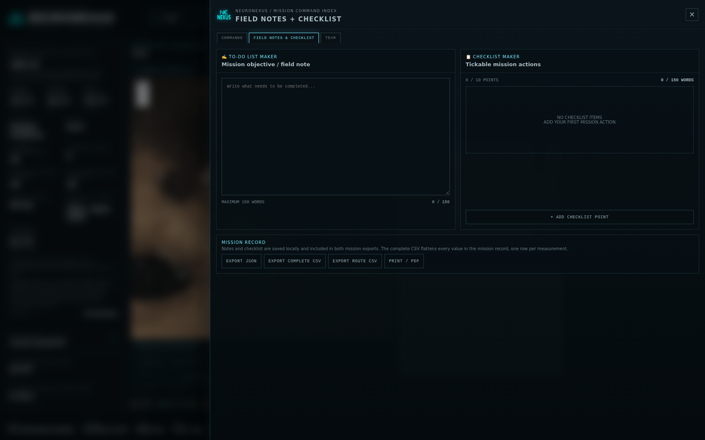

**Field notes and checklist.** A persistent mission objective note and a ten-item checklist, with JSON, CSV, route CSV and print/PDF exports. **NEW:** it now lives in a tab of the ☰ Command Index.

# Team

**Team NeuroNexus** · NASA International Space Apps Challenge 2026 · [Meet the Team](https://www.spaceappschallenge.org/2026/find-a-team/neuronexus1/)

© 2026 Team NeuroNexus. All rights reserved. Mars data courtesy of NASA, USGS and their partners. NASA does not endorse any non-U.S. Government entity and is not responsible for information contained on non-U.S. Government websites.
