# NeuroNexus — Interplanetary Survival Guide: Martian Map

NASA Space Apps Challenge 2026

## Mission

Build an interactive, scientifically grounded Martian map for exploring
terrain, environmental conditions, and human-survival-relevant information.

## Scientific Pipeline

NASA Mars data
    ↓
Data ingestion
    ↓
Validation
    ↓
Terrain processing
    ↓
GPU acceleration
    ↓
Terrain analysis
    ↓
Mesh generation
    ↓
GLB/GLTF assets
    ↓
Interactive 3D Mars experience

## Stack

- Python
- PyTorch + ROCm
- AMD Instinct MI300X
- NumPy / SciPy / Numba
- xarray / PyArrow / Polars
- PDS4 Tools
- Rasterio / GeoPandas
- VTK / PyVista / Trimesh
- React / Three.js (frontend)

## Principle

NASA data first.
Science first.
Validation first.
Visualization second.

Large datasets and generated assets remain outside Git.

# Architecture

```mermaid
flowchart TB
    USER["Mission operator"] --> APP

    subgraph FRONTEND["PRESENTATION LAYER · React 19 + Vite"]
        APP["App.jsx<br/>Shared mission state and UI orchestration"]

        MAP2D["2D Mars Explorer<br/>Leaflet · site search · map selection"]
        TOPO["MOLA Topographic Explorer<br/>Elevation tiles · contours · local terrain"]
        MAP3D["Interactive 3D Mars<br/>ArcGIS SceneView · loaded on demand"]
        ROUTEUI["Route Design & Comparison<br/>Waypoints · objective weights · EVA settings"]
        OPSUI["Science & Mission Panels<br/>Environment · hazards · thermal · rover photos<br/>Briefings · orbital tracking · mission operations"]
        INTELUI["Mars Intelligence<br/>Grounded Q&A · route trade-off explanations"]
        NOTES["Field Notes & Checklist<br/>Custom places · Safe Havens · exports"]

        CLIENT["marsEnvironmentApi.js<br/>REST / JSON client"]
        STORAGE[("Browser localStorage<br/>Saved routes · profile · places · notes<br/>Checklist · Safe Havens · objectives")]

        APP <--> MAP2D
        APP <--> TOPO
        APP <--> MAP3D
        APP <--> ROUTEUI
        APP <--> OPSUI
        APP <--> INTELUI
        APP <--> NOTES
        APP <--> STORAGE

        APP --> CLIENT
        MAP3D --> CLIENT
    end

    subgraph TRANSPORT["LOCAL API TRANSPORT"]
        PROXY["Vite proxy<br/>/api/* and /terrain/*"]
        API["FastAPI application · port 8002<br/>science/weather/api/environment.py"]
        PROXY <--> API
    end

    CLIENT <-->|"REST requests and JSON responses"| PROXY

    subgraph ROUTERS["FASTAPI DOMAIN ROUTERS"]
        SITEAPI["Environment & Place Catalogue<br/>Site context · USGS/IAU search"]
        TERRAINAPI["Terrain API<br/>Tiles · contours · windows · route geometry"]
        ROUTEAPI["Routing API<br/>Candidates · evaluation · methodology"]
        USGSAPI["USGS API<br/>Map synchronisation · route snapshots"]
        MARS3DAPI["Mars3D API<br/>Terrain grids · traverses · exploration zones"]
        HAZARDAPI["Hazards API<br/>Hazard overview · AI context"]
        MISSIONAPI["Mission API<br/>Explicitly simulated mission state"]
        ORBITAPI["Orbital API<br/>Near-Mars close approaches"]
        AIAPI["AI API<br/>Chat · route analysis · provenance"]
        MEDIAAPI["Briefing & Rover Media<br/>NASA and partner feeds · rover imagery"]
    end

    API --> SITEAPI
    API --> TERRAINAPI
    API --> ROUTEAPI
    API --> USGSAPI
    API --> MARS3DAPI
    API --> HAZARDAPI
    API --> MISSIONAPI
    API --> ORBITAPI
    API --> AIAPI
    API --> MEDIAAPI

    subgraph ENGINES["SCIENTIFIC & COMPUTATIONAL CORE"]
        ENV["MarsEnvironmentEngine<br/>Unified site context"]
        THERMAL["THEMIS Thermal Engine<br/>Historical brightness temperatures · coverage"]
        WEATHER["Mars Weather Model<br/>NASA Ames MY34 dust context"]
        TERRAIN["MOLA Terrain Processing<br/>Slope · roughness · relief · raster rendering"]
        ROUTING["Deterministic Multi-objective Route Engine<br/>Candidate generation · metrics · EVA estimates"]
        MAP3DENGINE["Mars 3D Context Builder<br/>Local terrain · rover traverses · study regions"]
        HAZARD["Hazard & Site Science Logic"]
        SIM["Mission Simulation Model<br/>Crew · vehicles · EVA · life support"]
        ORBITAL["Orbital Data Adapter"]
        MEDIA["Briefing & Imagery Adapters"]
        TOOLS["Server-side AI Tool Registry<br/>Reads structured site, terrain, route,<br/>thermal, hazard and orbital context"]
        PROVENANCE["Source Ledger & Evidence Classification<br/>Observed · Reference · Modelled · Derived<br/>Simulated · Unavailable"]
    end

    SITEAPI --> ENV
    SITEAPI --> PROVENANCE
    TERRAINAPI --> TERRAIN
    ROUTEAPI --> ROUTING
    USGSAPI --> PROVENANCE
    MARS3DAPI --> MAP3DENGINE
    HAZARDAPI --> HAZARD
    MISSIONAPI --> SIM
    ORBITAPI --> ORBITAL
    MEDIAAPI --> MEDIA
    AIAPI --> TOOLS
    AIAPI --> PROVENANCE

    subgraph LOCALDATA["LOCAL SCIENTIFIC DATA"]
        MOLA["NASA MOLA MEGDR<br/>Terrain tiles · Git LFS"]
        THEMIS["NASA THEMIS IR-PBT<br/>Indexed historical observations · Parquet"]
        DUST["NASA Ames Mars GCM · MY34<br/>NetCDF · external/mars-gcm submodule"]
        GAZETTEER["USGS / IAU Gazetteer<br/>Processed feature catalogue · Parquet"]
        MANIFEST["data/manifests<br/>Source ledger · checksums · dataset metadata"]
    end

    MOLA --> TERRAIN
    MOLA --> ROUTING
    MOLA --> MAP3DENGINE
    MOLA --> ENV

    THEMIS --> THERMAL
    THERMAL --> ENV

    DUST --> WEATHER
    WEATHER --> ENV

    GAZETTEER --> ENV
    MANIFEST --> PROVENANCE

    TOOLS --> ENV
    TOOLS --> THERMAL
    TOOLS --> TERRAIN
    TOOLS --> ROUTING
    TOOLS --> ORBITAL
    TOOLS --> PROVENANCE

    subgraph EXTERNAL["EXTERNAL DATA & SERVICES"]
        ARCGIS["Esri ArcGIS Mars Services<br/>Imagery · elevation · geology"]
        MMGIS["NASA MMGIS<br/>Rover traverse context"]
        JPL["NASA/JPL Close-Approach API"]
        FEEDS["NASA · ESA · Planetary Society<br/>Briefing feeds and mission context"]
        IMAGES["NASA Image and Video Library"]
        GEMINI["Google Gemini API<br/>Optional · server-side only"]
    end

    MAP3D <--> ARCGIS
    USGSAPI <--> ARCGIS
    MAP3DENGINE <--> MMGIS
    ORBITAL <--> JPL
    MEDIA <--> FEEDS
    MEDIA <--> IMAGES

    AIAPI <--> GEMINI
    GEMINI -. "Function-call requests" .-> TOOLS
    TOOLS -. "Structured tool results" .-> GEMINI

    ROUTING -. "Deterministic route metrics remain authoritative" .-> INTELUI
    ENV -. "Scientific context and evidence status" .-> OPSUI
```

# Stack
