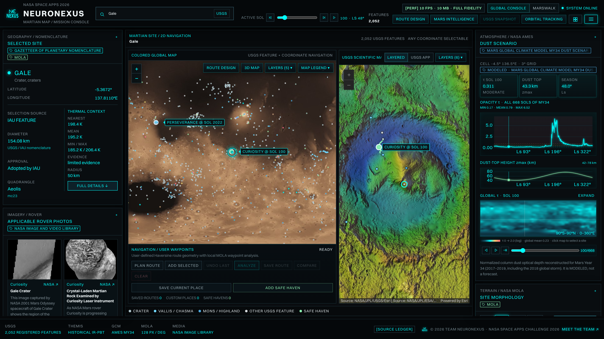
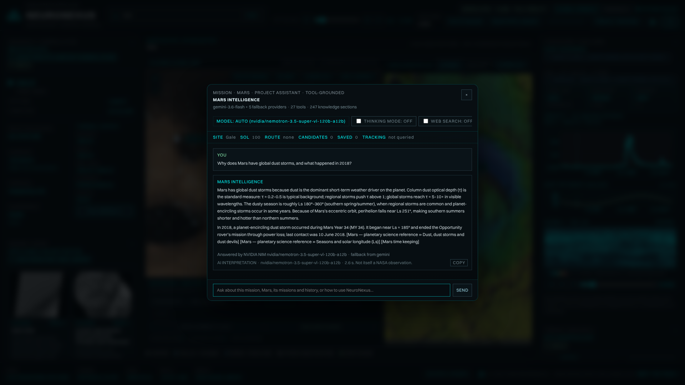
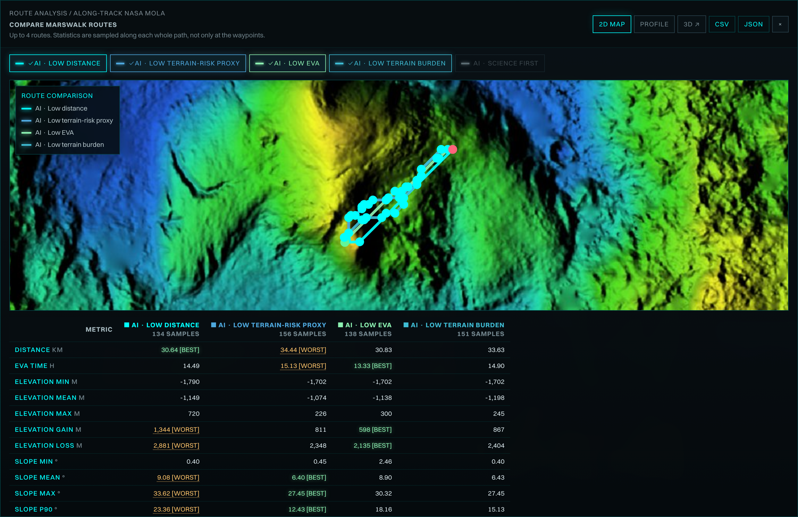
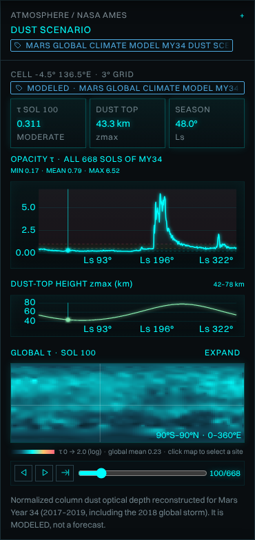
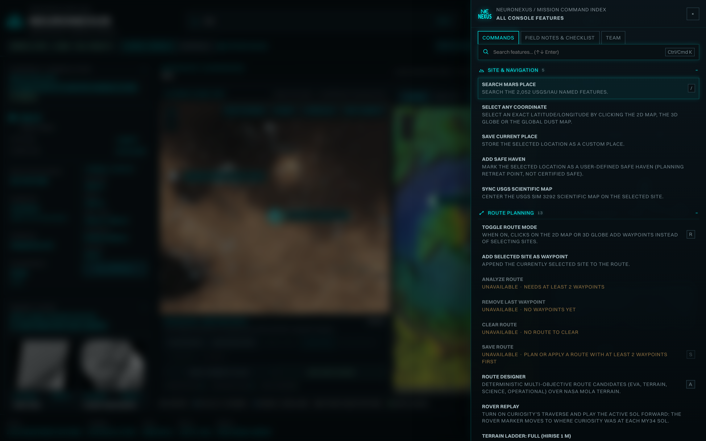
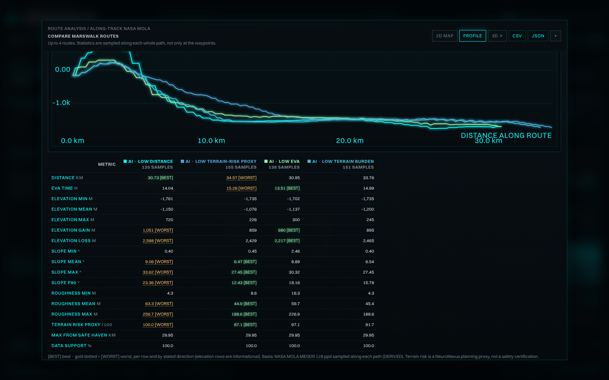
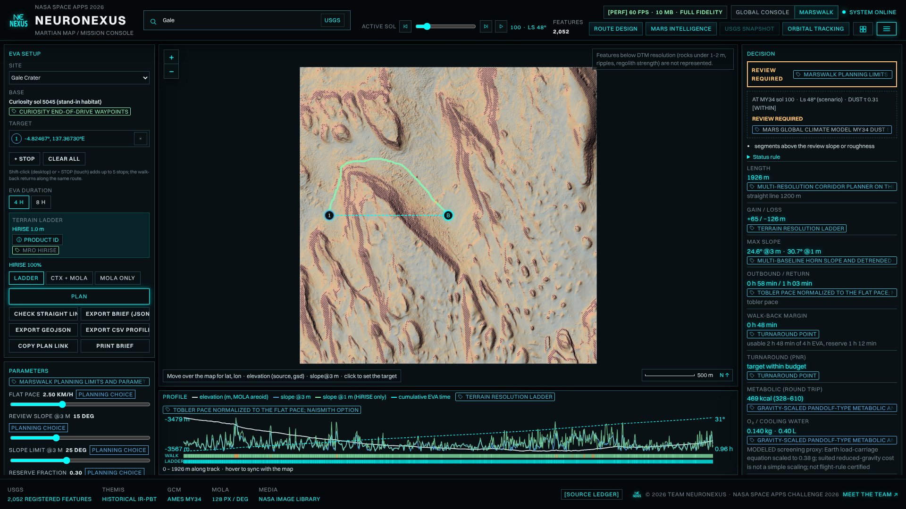
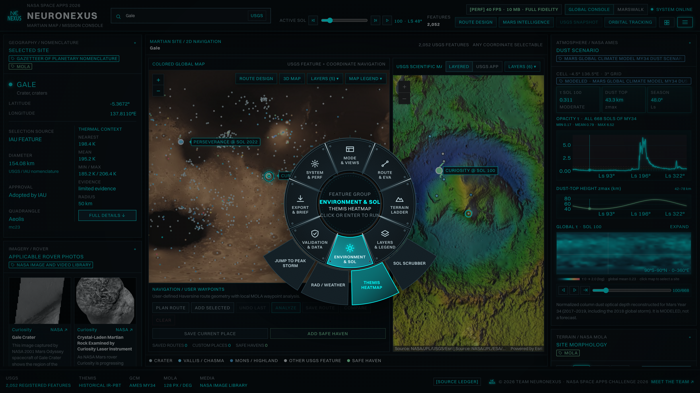
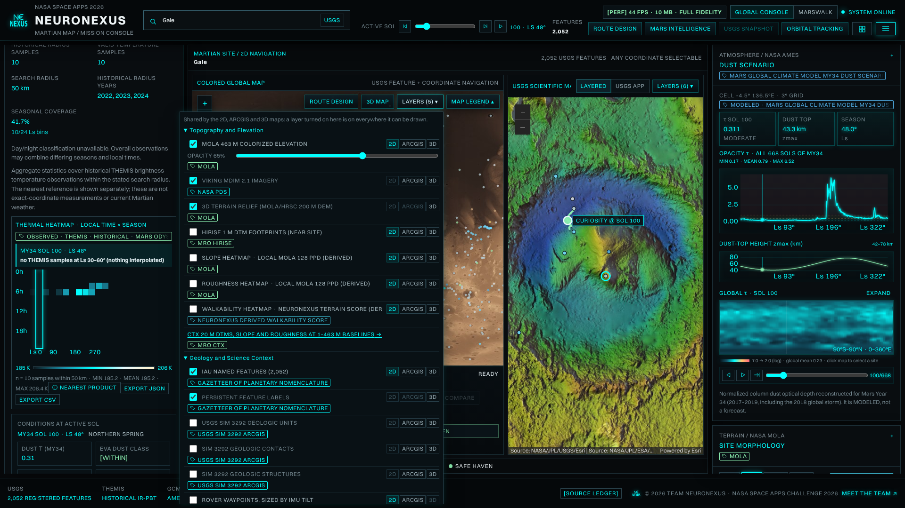

# What this branch adds over Master-Ai

Branch: `v4-argon-landing-routing`. Compared with `Master-Ai`
(last commit 13 Oct 2026, "Add Python dependencies to requirements.txt").

The two branches share no Git history, so this compares their file trees: 378 files differ outside `data/` and
images, +52,116 / -6,193 lines. Six frontend files exist only on Master-Ai and were not carried over:
`MarsMapInteractionLayer`, `RouteCompareOverlay`, `RouteUpgradeTools`, `UtilityDrawer`, `HazardDefencePanel`,
`RouteComparisonPanel` (all under `frontend/src/components/`).

## Master-Ai (before)

The first console: map, thermal, 3D, AI route design, and a Gemini assistant.

| Console | Mars Intelligence | Route comparison |
|---|---|---|
|  |  |  |

## Added in this branch

### 1. Gemini with fast fallback providers (newest)
- When Gemini fails, `science/ai/router.py` tries Groq, Mistral, NVIDIA NIM, GitHub Models, Cohere and OpenRouter in
  order (only those with a key set), once per model, no retries. A Gemini 401/403 also fails over to its next model.
- The chat shows which provider and model answered, and what it fell back from.
- Policy: no Chinese or Russian models or vendors (enforced by tests).

### 2. Mission Console v2 (14 Oct)
Dust scenario graphs, terrain statistics, site morphology, a command index, a team page, saved AI routes,
multi-route USGS snapshots, route comparison tables and 3D route projection.

| Dust scenario | Command index | Comparison table and profile |
|---|---|---|
|  |  |  |

### 3. v3: MARSWALK and radial wheel
MARSWALK planner (`science/marswalk/`: slope, pace, turnaround, EVA brief, dose screening), radial wheel menu,
ArcGIS layers, thermal synced to sol, phone layouts (iOS and Android), browser optimization, exports.

| MARSWALK mode | Radial wheel | Layers and legend |
|---|---|---|
|  |  |  |

### 4. Data and science modules
`science/hires/` (HiRISE and CTX terrain ladder), `science/conditions/` (MSL RAD dose, REMS weather),
`science/rovers/` (traverses and waypoints), `science/sources/` (source ledger), `science/validation/`
and `validation/reports/`, `science/ops/`, `science/usgs/` (route snapshots, sharper in the last commits).

### 5. v4: hosting
Split API across 20 free Render services (`render.yaml`, `science/serve_part.py`), sharded Vercel rewrites
(`tools/gen_vercel_rewrites.py`), memory and queue fixes, hourly warm-up (`tools/warm_link.py`).

### 6. Tests and tooling
Device checks (`frontend/e2e/`), 255 backend tests and 102 frontend tests passing, GitHub workflows,
a Hugging Face Space deploy kit (`deploy/space/`).

### More screenshots
Full tour (17 steps): `assets/screenshots/tour/`. Device review (desktop, iPad, iPhone): `assets/screenshots/review/`.
